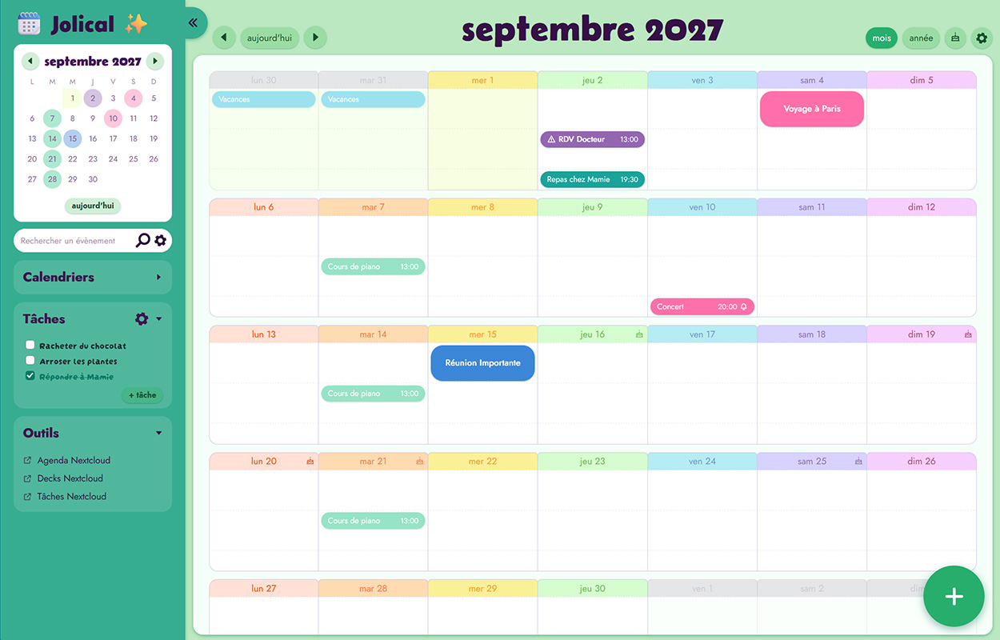

[🇫🇷 Français](README.md) · 🇬🇧 English

# Jolical 🗓️✨

**A web client for Nextcloud Calendar: simple, fast and fully customisable.**

**Pretty, but not only!**  
Jolical displays your Nextcloud calendars and tasks (CalDAV) in an interface designed to be pretty, but above all very practical and functional. It installs in a few minutes with Docker, next to your Nextcloud.

> **This project is provided as is and maintained in my spare time.**  
> Bug reports and suggestions are welcome, with no guaranteed response time.

> [!WARNING]
> **This project was coded by Claude**  
> The code, notes and documentation were generated by **Claude** (Anthropic), an artificial intelligence assistant, based on the ideas, choices and extensive testing of its author.



## Features

- **Views:**
  - A “Month” view: one row per week, each day split into three sections: morning / afternoon / evening
  - A “Year” view: month by month, with the option to highlight the important events of each month
  - A “Birthdays” calendar
  - A preview of the events of a day
  - A side panel: mini calendar, search bar, the calendars you can show or hide, task lists and tools
- **Events**: create, edit, duplicate, repeat, reminders (notification or email via Nextcloud), status (confirmed, tentative, cancelled), tags (Important (an icon before the name), Double size (in the “Month” view), Year view (to highlight the event there)), drag and drop from one day to another.
- **Tasks**: Nextcloud task lists, dated tasks shown in the calendar, grouping by list.
- **Birthdays**: dedicated calendar, computed age, special view.
- **External calendars** (.ics): public holidays, school holidays and up to 10 other calendars, updated automatically.
- **Appearance**: 4 bundled themes (Light, Dark, Light Green, Dark Green), simple mode or about a hundred advanced settings, your own themes and fonts, adjustable animations.
- **Languages**: French and English; add a language with a single file.
- **Installable app** (PWA) on phone, tablet and computer.
- **Integration into Nextcloud** via iframe
- **Offline mode**: if Nextcloud stops responding, the latest backup is shown read-only.
- **Keyboard shortcuts** (`?` key).

## Security

- The browser only talks to the Jolical server: the Nextcloud credentials (app password) stay on the server.
- Access protected by a password (scrypt hash), signed-in devices listed and revocable, progressive blocking after errors.
- Strict Content Security Policy (CSP), CSRF protection, filtered external downloads (anti-SSRF).
- Read-only, unprivileged container running as a non-root user.
- **No dependencies**: plain Node.js on the server, vanilla JavaScript in the browser.

## Requirements

- A Nextcloud server with the **Calendar** app (CalDAV); ideally a **dedicated user** with whom you share the calendars to display, with an **app password**.
- Docker and Docker Compose on the machine that will host Jolical.
- **To access it**, either:
  - **an HTTPS reverse proxy** (Nginx Proxy Manager, Caddy, Traefik…), recommended: encrypted connection, access from outside possible, installation as an app on phones;
  - **or direct access on your local network**, without a proxy: put the machine’s IP address in the `.env` file (`JOLICAL_BIND=192.168.1.10`), then open `http://192.168.1.10:6006`. The connection is then not encrypted (keep this to a trusted network) and browsers do not offer to install the app.

  By default, the Jolical port is only open on the machine itself (see [docs/en/INSTALLATION.md](docs/en/INSTALLATION.md), section 7).

## Quick installation

```bash
git clone https://github.com/remyrenard/jolical.git
cd jolical

# 1. Credentials
cp config.secret.example config.secret
nano config.secret                      # Nextcloud address, user, app password

# 2. Jolical password: copy the APP_PASSWORD_HASH=… line it prints into config.secret
docker compose run --rm jolical node hash.js

# 3. File permissions (container user: 1000)
sudo chown 1000:1000 config.secret && chmod 600 config.secret

# 4. Start
docker compose up -d --build
```

Then point your HTTPS proxy to `http://127.0.0.1:6006` (or, without a proxy, set `JOLICAL_BIND` as explained in the requirements).  
The first time you open it, Jolical asks for your language.

The full guide (proxy in Docker, local network access, forgotten password, unblocking, signing out devices, themes, texts):
[**docs/en/INSTALLATION.md**](docs/en/INSTALLATION.md).

### Updating

```bash
git pull
docker compose up -d --build
```

Your settings, themes and signed-in devices are kept (Docker volume `jolical-data`).

## Customisation

| What                               | Where                                                                                     |
|------------------------------------|-------------------------------------------------------------------------------------------|
| Themes, colours, fonts, animations | Settings > Appearance (simple mode, or “Advanced settings”)                               |
| Your fonts (.woff2, .ttf, .otf)    | `custom/fonts/` folder                                                                    |
| Changing texts                     | `custom/texts/texts_EN.perso.json` (see [custom/texts/README.md](custom/texts/README.md)) |
| Adding a language                  | `custom/texts/texts_XX.json`, then General settings > Language                            |
| Free CSS                           | Settings > Appearance > Advanced settings > Custom CSS                                    |

The full list of settings is in [docs/PARAMETRES.md](docs/PARAMETRES.md) and the internals are described in
[docs/NOTES.md](docs/NOTES.md) (both in French for now).

## Contributing

Contributions go through GitHub:

1. **Report a bug or suggest an idea**: open an *issue* describing what you did, what you expected and what happened (browser version, container logs if possible: `docker compose logs jolical`).
2. **Suggest a change**: *fork* the repository, create a branch, then open a *pull request*. Before sending it, run `node check.js` (automatic check, also run when the Docker image is built).

A few code rules: no external dependencies, no hard-coded displayed text (everything goes through `texts/texts_FR.json`
and `texts/texts_EN.json`), end-of-line comments only. Translations into other languages are welcome.

## Credits

- **Bundled fonts** (SIL Open Font License 1.1, see [fonts/LICENSE-fonts.txt](fonts/LICENSE-fonts.txt)): [Jost](https://github.com/indestructible-type/Jost), [Belanosima](https://github.com/docrepair-fonts/belanosima-fonts), [Darumadrop One](https://github.com/ManiackersDesign/darumadrop), converted by [Fontsource](https://fontsource.org).
- Jolical is not affiliated with Nextcloud GmbH; Nextcloud is a trademark of Nextcloud GmbH.

## License

This program is free software, distributed under the **GNU Affero General Public License v3.0** (AGPL-3.0):
see the [LICENSE](LICENSE) file. You may use, study, modify and redistribute it; if you offer a modified version
to other people over a network, you must also give them access to its source code.
