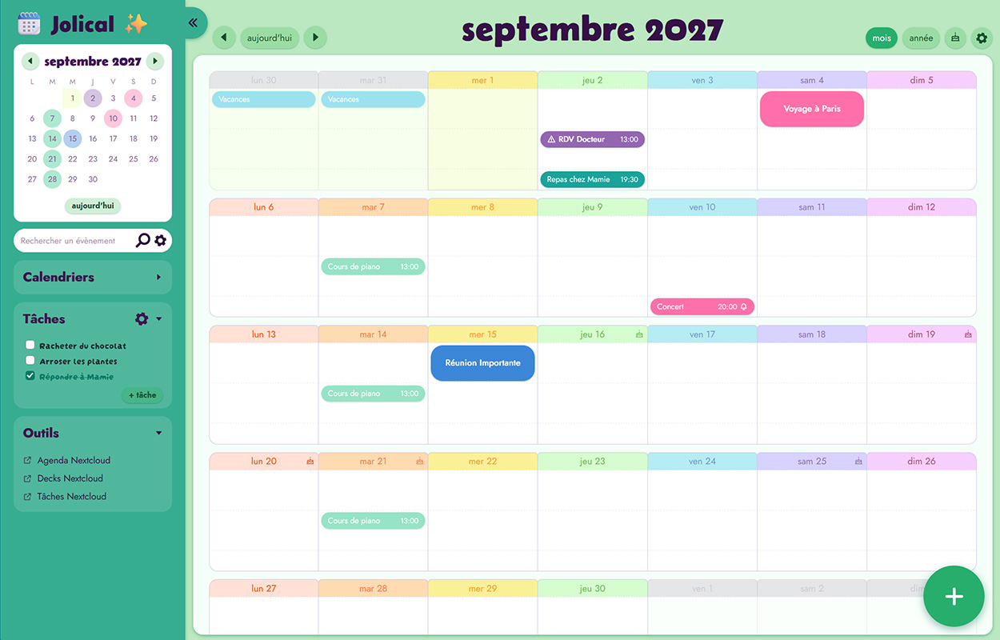

🇫🇷 Français · [🇬🇧 English](README.en.md)

# Jolical 🗓️✨

**Un client web pour Nextcloud Agenda, simple, rapide et entièrement personnalisable.**

**Joli, mais pas que !**  
Jolical affiche vos calendriers et vos tâches Nextcloud (CalDAV) dans une interface pensée pour être jolie mais surtout très pratique et fonctionnelle. Il s'installe en quelques minutes avec Docker, à côté de votre Nextcloud.

> **Ce projet est fourni tel quel, il est maintenu sur mon temps libre.**  
> Les signalements de bugs et les propositions sont les bienvenus, sans garantie de délai de réponse.

> [!WARNING]
> **Ce projet a été codé par Claude**  
> Le code, les notes et la documentation ont été générés par **Claude** (Anthropic), un assistant d'intelligence artificielle, à partir des idées, des choix et des nombreux tests de son auteur.



## Fonctionnalités

- **Vues :**
  - Une vue “Mois” : affichage par semaine, chaque jour est découpé en trois sections matin / après-midi / soir
  - Une vue “Année” : affichage mensuel avec possibilité de mettre en avant les évènements importants du mois.
  - Un calendrier des “Anniversaires”
  - Un aperçu des évènements d’une journée
  - Un volet latéral : un mini-calendrier, une barre de recherche, les différents calendrier affichables, liste de tâches et outils.
- **Évènements** : création, modification, duplication, répétitions, rappels (notification ou e-mail via Nextcloud), statut (confirmé, provisoire, annulé), tags (Important (ajout d’un picto devant le nom), Double taille (dans la vue “Mois”), Vue Année (pour y mettre en avant l’évènement)), glisser-déposer d'un jour à l'autre.
- **Tâches** : listes de tâches Nextcloud, tâches datées affichées dans l'agenda, classement par liste.
- **Anniversaires** : calendrier dédié, âge calculé, vue spéciale.
- **Calendriers externes** (.ics) : jours fériés, vacances scolaires, et jusqu'à 10 autres calendriers, mis à jour automatiquement.
- **Apparence** : 4 thèmes fournis (Clair, Sombre, Vert Clair, Vert Foncé), mode simple ou une centaine de réglages avancés, vos propres thèmes et vos polices, animations réglables.
- **Langues** : français et anglais ; ajout d'une langue par un simple fichier.
- **Application installable** (PWA) sur téléphone, tablette et ordinateur.
- **Intégration dans Nextcloud** via iframe
- **Mode hors-ligne** : si Nextcloud ne répond plus, la dernière sauvegarde est affichée en lecture seule.
- **Raccourcis clavier** (touche `?`).

## Sécurité

- Le navigateur ne parle qu'au serveur Jolical : les identifiants Nextcloud (mot de passe d'application) restent sur le serveur.
- Accès protégé par un mot de passe (empreinte scrypt), appareils connectés listés et révocables, blocage progressif en cas d'erreurs.
- Politique de sécurité du contenu (CSP) stricte, protection CSRF, téléchargements externes filtrés (anti-SSRF).
- Conteneur en lecture seule, sans privilèges, utilisateur non-root.
- **Aucune dépendance** : Node.js seul côté serveur, JavaScript natif côté navigateur.

## Prérequis

- Un serveur Nextcloud avec l'application **Agenda** (CalDAV) ; idéalement un **utilisateur dédié** à qui vous partagez les calendriers à afficher, avec un **mot de passe d'application**.
- Docker et Docker Compose sur la machine qui hébergera Jolical.
- **Pour y accéder**, au choix :
  - **un proxy inverse en HTTPS** (Nginx Proxy Manager, Caddy, Traefik…), recommandé : connexion chiffrée, accès possible depuis l'extérieur, installation comme application sur téléphone ;
  - **ou un accès direct sur votre réseau local**, sans proxy : indiquez l'adresse IP de la machine dans le fichier `.env` (`JOLICAL_BIND=192.168.1.10`), puis ouvrez `http://192.168.1.10:6006`. La connexion n'est alors pas chiffrée (à réserver à un réseau de confiance) et les navigateurs ne proposent pas d'installer l'application.

  Par défaut, le port de Jolical n'est ouvert que sur la machine elle-même (voir [docs/INSTALLATION.md](docs/INSTALLATION.md), section 7).

## Installation rapide

```bash
git clone https://github.com/remyrenard/jolical.git
cd jolical

# 1. Identifiants
cp config.secret.example config.secret
nano config.secret                      # adresse de Nextcloud, utilisateur, mot de passe d'application

# 2. Mot de passe de Jolical : copier la ligne APP_PASSWORD_HASH=… affichée dans config.secret
docker compose run --rm jolical node hash.js

# 3. Droits du fichier (utilisateur du conteneur : 1000)
sudo chown 1000:1000 config.secret && chmod 600 config.secret

# 4. Démarrage
docker compose up -d --build
```

Puis faites pointer votre proxy HTTPS vers `http://127.0.0.1:6006` (ou, sans proxy, réglez `JOLICAL_BIND` comme indiqué dans les prérequis).  
À la première ouverture, Jolical vous demande votre langue.

Le guide complet (proxy dans Docker, accès en réseau local, mot de passe oublié, déblocage, déconnexion des appareils, thèmes, textes) :
[**docs/INSTALLATION.md**](docs/INSTALLATION.md).

### Mise à jour

```bash
git pull
docker compose up -d --build
```

Vos réglages, thèmes et appareils connectés sont conservés (volume Docker `jolical-data`).

## Personnalisation

| Quoi                                  | Où                                                                                         |
|---------------------------------------|--------------------------------------------------------------------------------------------|
| Thèmes, couleurs, polices, animations | Paramètres > Apparence (mode simple, ou « Paramètres avancés »)                            |
| Vos polices (.woff2, .ttf, .otf)      | dossier `custom/fonts/`                                                                    |
| Personnalisation des textes           | `custom/texts/texts_FR.perso.json` (voir [custom/texts/README.md](custom/texts/README.md)) |
| Ajouter une langue                    | `custom/texts/texts_XX.json`, puis Paramètres généraux > Langue                            |
| CSS libre                             | Paramètres > Apparence > Paramètres avancés > Custom CSS                                   |

La liste complète des réglages est dans [docs/PARAMETRES.md](docs/PARAMETRES.md),
et le fonctionnement interne dans [docs/NOTES.md](docs/NOTES.md).

## Contribuer

Les contributions passent par GitHub :

1. **Signaler un bug ou proposer une idée** : ouvrez une *issue* en décrivant ce que vous avez fait, ce que vous attendiez et ce qui s'est passé (version du navigateur, logs du conteneur si possible : `docker compose logs jolical`).
2. **Proposer une modification** : faites un *fork* du dépôt, créez une branche, puis ouvrez une *pull request*. Avant de l'envoyer, lancez `node check.js` (contrôle automatique, aussi exécuté à la construction de l'image Docker).

Quelques règles du code : aucune dépendance externe, aucun texte affiché écrit en dur (tout passe par `texts/texts_FR.json`
et `texts/texts_EN.json`), commentaires en fin de ligne seulement. Les traductions dans d'autres langues sont bienvenues.

## Crédits

- **Polices fournies** (licence SIL Open Font License 1.1, voir [fonts/LICENSE-fonts.txt](fonts/LICENSE-fonts.txt)) : [Jost](https://github.com/indestructible-type/Jost), [Belanosima](https://github.com/docrepair-fonts/belanosima-fonts), [Darumadrop One](https://github.com/ManiackersDesign/darumadrop), converties par [Fontsource](https://fontsource.org).
- Jolical n'est pas affilié à Nextcloud GmbH ; Nextcloud est une marque de Nextcloud GmbH.

## Licence

Ce programme est un logiciel libre, distribué sous la licence **GNU Affero General Public License v3.0** (AGPL-3.0) :
voir le fichier [LICENSE](LICENSE). Vous pouvez l'utiliser, l'étudier, le modifier et le redistribuer ; si vous proposez
une version modifiée à d'autres personnes à travers un réseau, vous devez aussi leur donner accès à son code source.